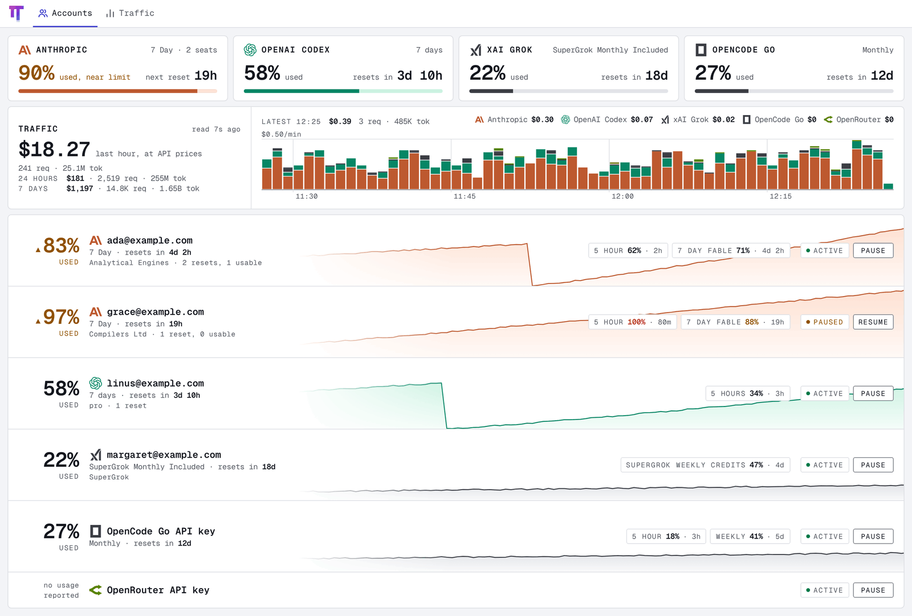
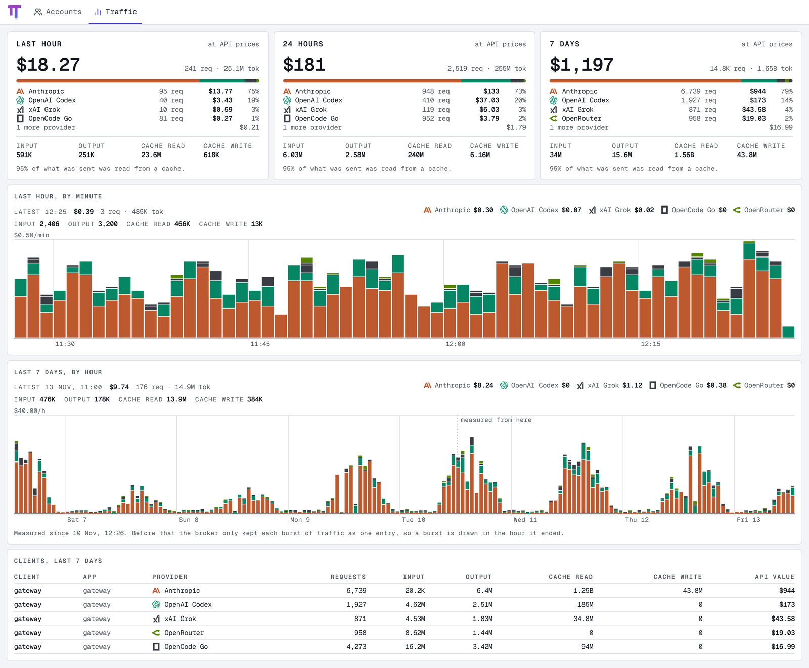

# oh-my-usage

A dashboard for an [omp](https://github.com/can1357/oh-my-pi) auth gateway.
`oh-my-usaged` is one static binary: it polls the gateway, serves a web UI
that shows how much quota is used and when it resets, keeps a usage history in
SQLite, and, when it is also given the broker, shows the traffic passing
through and can pause an account.

## What you see

<picture>
  <source media="(prefers-color-scheme: dark)" srcset="docs/screenshots/accounts-dark.png" />
  
</picture>

Every figure is quota **used**.

- **Totals**, one per provider: how much of its main usage window is used
  across all its accounts, and how long until the next reset. The main window
  is the one that resets last: a week rather than five hours.
- **Accounts**, one band each, drawn over the last seven days of what the
  account had used. A band leads with the large figure for its main window,
  then the account's name and when that window resets; its other windows are
  the small values on the right. A figure turns amber with a ▲ at four
  fifths used and red with a ■ at all of it.
- **Colour**: a provider's mark, gauge and chart wear its brand's colour
  (Anthropic orange, OpenAI green, OpenRouter lime, Google blue, MiniMax
  magenta… and grey for a brand that is black and white: OpenCode, Cursor,
  GitHub Copilot, xAI, Ollama, Z.ai), so colour says whose usage it is and
  the figure says how bad it is.
  Every provider omp 18.19.0 can hold a credential for has a name, and 82 of
  its 104 have their mark; the rest show their initial.
- **An account's page**: the same band, then a card for each usage window
  with how much of the window's time has gone (the tick on its gauge), how
  fast it is filling and whether at that pace it runs out before it resets;
  a chart of every window over the last seven days, with a table of the same
  values; the limit resets the account has saved, with what each would clear
  and when it lapses; and whether omp is sending it traffic, with any blocks
  omp has put on it.
- **Traffic**, with a broker: what is passing through the gateway. A band on
  the first page gives the last hour's requests, tokens and cost at API
  prices, with the hour drawn minute by minute; the Traffic page adds the day
  and the week by provider, tokens by kind (input, output, cache read, cache
  write), the week by hour, and who sent it.

A window's pace is read from the usage recorded over its recent past (the
last day of a week-long window), or, until enough is recorded, from its
average since it opened. It is a straight line from there, not a prediction
of what you will do next.

The layout is one column on a phone and fills the width of a desktop.

## Quick start

Go 1.27 and golangci-lint 2.15 (`.tool-versions`); Node 26 and pnpm 12
(`package.json`).

```bash
pnpm install
make build WEB=1

export OH_MY_USAGE_GATEWAY_TOKEN=...   # the gateway's bearer token
build/bin/oh-my-usaged -gateway-url https://omp.example.com
# http://127.0.0.1:8080; -h lists flags
```

To see traffic and pause accounts, add the broker:

```bash
export OH_MY_USAGE_BROKER_TOKEN=...    # the broker's admin token
build/bin/oh-my-usaged -gateway-url http://auth-gateway:4019 -broker-url http://auth-broker:8765
```

## Configuration

| Flag                        | Environment                 | Default           |                                                             |
| --------------------------- | --------------------------- | ----------------- | ----------------------------------------------------------- |
| `-gateway-url`              | `OH_MY_USAGE_GATEWAY_URL`   | required          | The omp auth gateway.                                       |
| `-gateway-token-file`       | `OH_MY_USAGE_GATEWAY_TOKEN` | required          | The gateway token: a file holding it, or the variable.      |
| `-broker-url`               | `OH_MY_USAGE_BROKER_URL`    | none              | The omp auth broker. Setting it turns traffic and pause on. |
| `-broker-token-file`        | `OH_MY_USAGE_BROKER_TOKEN`  | none              | The broker admin token.                                     |
| `-listen`                   |                             | `127.0.0.1:8080`  | HTTP listen address.                                        |
| `-db`                       |                             | `oh-my-usage.db`  | SQLite file for the usage history and the traffic record.   |
| `-poll-interval`            |                             | `1m`              | Time between polls, at least `30s`.                         |
| `-traffic-interval`         |                             | `15s`             | Time between readings of the broker's traffic, at least 5s. |
| `-retention`                |                             | `2160h` (90 days) | How long both are kept; `0` keeps them forever.             |
| `-log-format`, `-log-level` |                             | `text`, `INFO`    |                                                             |

A flag wins over its variable. Tokens are never taken as flag values, so they
do not show in the process list.

## What it reads and changes

- **Gateway** (`GET /v1/usage`, `GET /healthz`): read-only. The gateway caches
  for 15 s and the broker behind it for about 5 min per account, so a poll each
  minute costs the providers nothing extra.
- **Broker** (`GET /v1/snapshot`, `GET /v1/usage/clients`,
  `POST`/`DELETE /v1/credential/:id/block`): only when configured. The
  snapshot carries live access tokens and API keys; oh-my-usage decodes only
  each credential's ID, provider, identity and blocks, so those secrets are
  never held or logged. The broker admin token itself can read every stored
  token: treat it like the credentials.

## Traffic

<picture>
  <source media="(prefers-color-scheme: dark)" srcset="docs/screenshots/traffic-dark.png" />
  
</picture>

The broker counts every request the gateway serves: requests, the four kinds
of token, and what they would cost at the provider's API prices. On a
subscription nothing is billed per token, so read the cost as a measure of
work done, not as a bill.

- **Measured from the first reading on.** The broker keeps running totals;
  oh-my-usage reads them every 15 s and records how much they grew. That is
  exact to the reading. The broker reports by client, application and
  provider, not by account or model, so neither does the page.
- **Estimated before it.** The broker keeps each burst of traffic as one
  entry stamped with its last request, so the days before the first reading
  can only be drawn with each burst in the hour it ended: a long burst shows
  as one tall hour. The estimate counts in the day, the week and the chart by
  hour, never in the last hour or the chart by minute, and the chart marks
  where measuring began.
- **While the daemon is stopped** nothing is lost: the next reading measures
  everything that passed, spread evenly over the gap (by the hour, as an
  estimate, when the gap is over an hour).

## Pausing an account

omp has no way to turn a disabled account back on short of logging in again,
so the control here is a pause, not omp's `disable`. A pause is a block in
omp's `account-policy` scope with a far-future deadline:

- omp moves traffic off the account within seconds, and the pause survives
  quota resets and broker restarts.
- **A paused account is used last, not never.** omp still falls back to it
  when every other account of the provider is blocked or out of quota.
- omp sets short `account-policy` blocks of its own (a provider refusing an
  account). Only a block with the pause's deadline counts as paused, and
  resuming removes nothing else.
- Redeeming a saved Codex reset in omp clears every block on that account,
  a pause included.

## Security

There is no login. The UI shows account emails and, with a broker, can pause
accounts: listen on loopback and put it behind a reverse proxy with
authentication, or on a private network such as a tailnet.

## Development

```bash
make check     # what CI runs: lint, generated-code check, tests, govulncheck, tidy
make run       # build and serve with whatever web/dist holds; needs the gateway variables
```

UI work: run the daemon, then `pnpm --dir web dev` (:5173, proxies `/api/`;
`API=http://host:port` points it elsewhere). `make storybook` (:6006). Browser
tests need `pnpm --dir web exec playwright install chromium`. `make help`
lists targets. Rules and layout: [AGENTS.md](AGENTS.md),
[web/AGENTS.md](web/AGENTS.md).

The screenshots in `docs/screenshots/` are the two `Showcase` stories
(Pages/Accounts and Pages/Traffic) in each theme, taken 1440 pixels wide at
twice the density and saved 1600 pixels wide in 256 colours.

Where things live:

- `api/openapi.yaml`: the API. It generates the Go server (`api/rest/`) and
  the web client (`web/src/api/`).
- `pkg/accounts/`: joins the gateway's usage reports with the broker's
  credentials into accounts. Pure.
- `internal/omp/`: the gateway and broker HTTP clients.
- `internal/monitor/`: the poll loop, the latest state, and pausing.
- `internal/store/`: the SQLite usage history.
- `internal/server/`, `internal/ui/`: the API, the event stream and the
  embedded UI.
- `web/src/pages/accounts/`: the accounts page and the account page.
- `web/src/lib/`: what the pages work out: totals (`pools.ts`), an account's
  main window (`accounts.ts`), chart paths (`sparkline.ts`), provider marks
  (`providerMarks.ts`).
- `web/src/styles/tokens.css`: the theme. Dark is the one it is drawn for.

Built from [Savid/skeleton](https://github.com/Savid/skeleton).

## Credits

- The typeface is [Geist Mono](https://vercel.com/font) (SIL Open Font
  License), shipped in the binary.
- The logo is [oh-my-pi](https://github.com/can1357/oh-my-pi)'s mark (MIT)
  with its legs redrawn as usage meters.
- Provider marks are from [Simple Icons](https://simpleicons.org) (CC0) and
  [Lobe Icons](https://github.com/lobehub/lobe-icons) (MIT). Each is its
  owner's trademark, used only to name the provider.

## License

[MIT](LICENSE)
